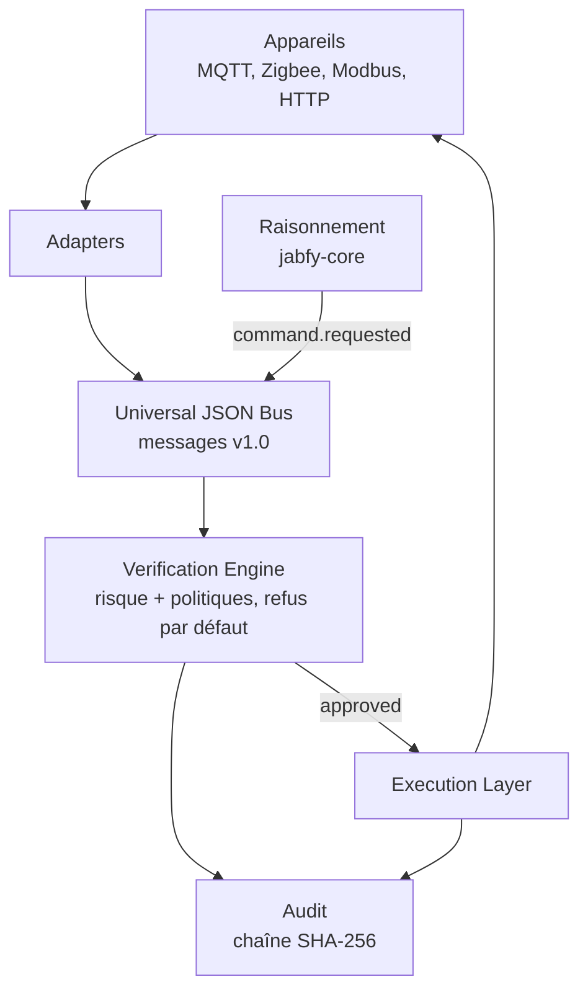

# jabfy-bus

jabfy-bus est la couche de normalisation d'événements IoT de Jabfy. Chaque protocole (MQTT, Zigbee2MQTT, Modbus TCP, HTTP…) est traduit vers un message JSON commun, **chaque commande est vérifiée avant exécution**, et chaque décision est tracée dans un journal d'audit append-only, chaîné en SHA-256.

## Rôle dans l'architecture



jabfy-bus est une bibliothèque Python : jabfy-core et jabfy-simulation l'embarquent dans leur processus. Le moteur de vérification accepte un `authorizer` externe, ce qui permet de déléguer la décision à jabfy-guard.

| Utilisé par | Comment |
|---|---|
| jabfy-core | bus, vérification, exécution et WebSockets hébergés dans le processus de Core |
| jabfy-simulation | bus embarqué avec jabfy-guard pour la maison virtuelle |

## Pages

- [Architecture et flux des messages](architecture.md)
- [Schéma de message v1.0](message-schema.md)
- [Sécurité, risques et politiques](security.md)
- [Guide des adapters](adapters.md)
- [Roadmap technique](roadmap.md)
- [Documentation du code, fichier par fichier](code/README.md)

## Installation

```bash
pip install .            # cœur, bibliothèque standard uniquement
pip install ".[all]"     # + paho-mqtt, fastapi/uvicorn, pymodbus, pyyaml
```

## Tests

```bash
make test
make demo          # scénario mouvement → lumière en simulation
```
